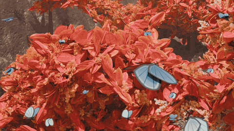
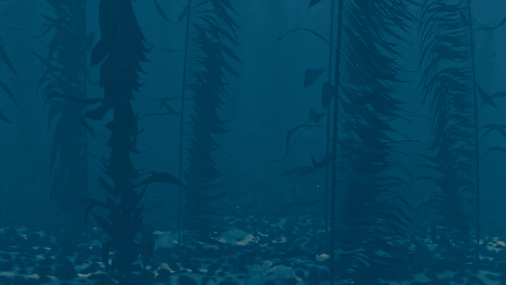

<p align="center">
  <picture>
    <source media="(prefers-color-scheme: dark)" srcset="assets/logo_dark.png">
    
  </picture>
</p>

<h3 align="center">Open-Ended Photorealistic 3D Worlds through Procedural Generation</h3>

<p align="center">
  <a href="https://yichuanh.github.io/">Yi-Chuan Huang</a><sup>1,2</sup> ·
  <a href="https://chien90190.github.io/">Hao-Jen Chien</a><sup>2</sup> ·
  <a href="https://brian90709.github.io/">Zheng-Hui Huang</a><sup>1,3</sup> ·
  <a href="https://yulunalexliu.github.io/">Yu-Lun Liu</a><sup>2</sup> ·
  <a href="https://kpzhang93.github.io/">Kaipeng Zhang</a><sup>1</sup> ·
  <a href="https://lightchaserx.github.io/">Zhixiang Wang</a><sup>1</sup>
</p>

<p align="center">
  <sup>1</sup><a href="https://alayalab.ai/">Alaya Lab</a> &nbsp; <sup>2</sup>National Yang Ming Chiao Tung University &nbsp; <sup>3</sup>National Taiwan University
</p>

<p align="center">
  <a href="https://arxiv.org/abs/2610.26853"></a>
  <a href="https://huggingface.co/papers/2610.26853"></a>
  <a href="https://yichuanh.github.io/infinidream-page/"></a>
  
</p>

---

InfiniDream turns a single text prompt into a photorealistic, open-ended 3D world. A VLM plans the scene and edits sophisticated procedural code rather than raw geometry, so every asset stays high-quality, every scene stays coherent, and a new seed grows a new world.

### 🚧 Full version coming soon 🚧

⭐ **Code is on the way. Star the repo to get notified when it lands.**

## From a sentence to a living world

<p align="center"></p>

Objects are planned, generated, and placed one by one into a living, animated scene.

## Worlds InfiniDream dreamed up

<p align="center"></p>

Every scene starts as one sentence. Twenty worlds and counting, all animated, all procedural.

## Quality beyond existing VLM methods

<p align="center"></p>

The same objects, written by VLM-driven baselines and by InfiniDream. Each tile wipes from the baseline to ours.

## New seed, new variant

<p align="center"></p>

One program per object. Swapping the seed produces endless high-quality variants, which makes large diverse scenes cheap to build.

## Precise edits, whole worlds

<p align="center"></p>

A vanilla procedural scene, before and after InfiniDream rewrites it to match the prompt.

## Citation

```bibtex
@article{infinidream2026,
  title   = {InfiniDream: Open-Ended Photorealistic 3D Worlds
             through Procedural Generation},
  author  = {Huang, Yi-Chuan and Chien, Hao-Jen and Huang, Zheng-Hui
             and Liu, Yu-Lun and Zhang, Kaipeng and Wang, Zhixiang},
  journal = {arXiv preprint arXiv:2610.26853},
  year    = {2026}
}
```
