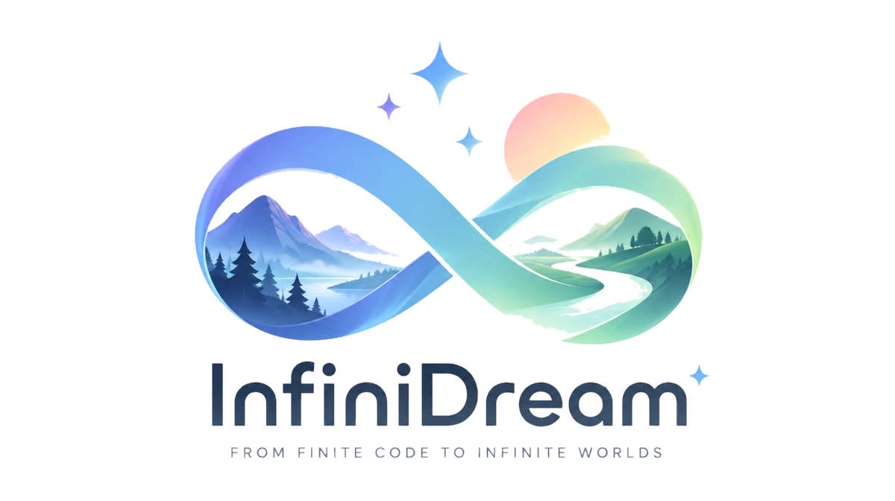
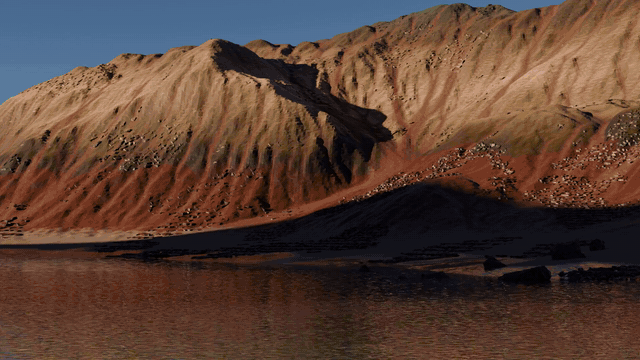

<p align="center">
  <picture>
    <source media="(prefers-color-scheme: dark)" srcset="assets/logo_dark.png">
    
  </picture>
</p>

<h3 align="center">Open-Ended Photorealistic 3D Worlds through Procedural Generation</h3>

<p align="center">
  <a href="https://yichuanh.github.io/">Yi-Chuan Huang</a><sup>1,2</sup> ·
  <a href="https://chien90190.github.io/">Hao-Jen Chien</a><sup>2</sup> ·
  <a href="https://brian90709.github.io/">Zheng-Hui Huang</a><sup>1,3</sup> ·
  <a href="https://yulunalexliu.github.io/">Yu-Lun Liu</a><sup>2</sup> ·
  <a href="https://kpzhang93.github.io/">Kaipeng Zhang</a><sup>1</sup> ·
  <a href="https://lightchaserx.github.io/">Zhixiang Wang</a><sup>1</sup>
</p>

<p align="center">
  <sup>1</sup><a href="https://alayalab.ai/">Alaya Lab</a> &nbsp; <sup>2</sup>National Yang Ming Chiao Tung University &nbsp; <sup>3</sup>National Taiwan University
</p>

<p align="center">
  <a href="https://arxiv.org/abs/2610.26853"></a>
  <a href="https://huggingface.co/papers/2610.26853"></a>
  <a href="https://yichuanh.github.io/infinidream-page/"></a>
  
</p>

---

InfiniDream turns a single text prompt into a photorealistic, open-ended 3D world. A VLM plans the scene and edits sophisticated procedural code rather than raw geometry, so every asset stays high-quality, every scene stays coherent, and a new seed grows a new world.

> **Release status.** This release is the **API-key version**: planning and review calls go to the Claude API and the coding agent is Claude Code CLI, so you need a `CLAUDE_API_KEY` (see [What you need](#what-you-need)). A version that runs entirely on open-weight models (Qwen) is under development; the adapters are already in `llm_backends/` but are experimental. Jump to [Install](#install-one-time) and [Run](#run).

## From a sentence to a living world

<p align="center"></p>

Objects are planned, generated, and placed one by one into a living, animated scene.

---

## What you need

| | Required | Notes |
|---|---|---|
| Linux + NVIDIA GPU | yes | tested on RTX 4090 (24 GB), driver 580, CUDA 12/13 |
| conda | yes | Python 3.11 env, see below |
| Infinigen checkout | yes | pinned commit + our patch, see step 2 |
| `CLAUDE_API_KEY` | yes | all planning / review calls **and** the coding agent (Claude Code CLI) |
| Node.js ≥ 18 + Claude Code CLI | yes | the coding agent: `npm i -g @anthropic-ai/claude-code` |
| Reference-image source | one of | Gemini key **or** any OpenAI-compatible image endpoint **or** local Z-Image-Turbo (no key, 33 GB download) |
| ffmpeg | for the video | `conda install ffmpeg` (already in `environment.yml`) |

Disk: one baseline scene is 2–7 GB, one pipeline run 5–40 GB. Keep `output/` on a big disk.

## Install (one time)

### 1. Conda environment

```bash
git clone <this repo> InfiniDream && cd InfiniDream
conda env create -f environment.yml          # creates env "infinidream" (python 3.11 + pip deps)
conda activate infinidream
```

If `pip` installed a CPU-only torch, reinstall the CUDA build for your driver, e.g.
`pip install torch==2.11.0 torchvision==0.26.0 --index-url https://download.pytorch.org/whl/cu130`.
Torch is only needed for the local reference-image model; the rest of the pipeline does not use it.

### 2. Infinigen (pinned commit + patch)

```bash
git clone https://github.com/princeton-vl/infinigen.git third_party/infinigen
cd third_party/infinigen
git checkout v1.19.0
git apply ../infinigen.patch                                   # our fixes on top of v1.19.0 (creatures, task hooks)
cp -r ../infinigen_configs/* infinigen_examples/configs_nature/ # extra gin configs (underwater fix, ...)
# Infinigen's own install (terrain build takes a few minutes):
export C_INCLUDE_PATH=$CONDA_PREFIX/include:$C_INCLUDE_PATH CPLUS_INCLUDE_PATH=$CONDA_PREFIX/include:$CPLUS_INCLUDE_PATH
export LIBRARY_PATH=$CONDA_PREFIX/lib:$LIBRARY_PATH LD_LIBRARY_PATH=$CONDA_PREFIX/lib:$LD_LIBRARY_PATH
pip install -e ".[terrain,vis]"
cd ../..
```

Sanity check: `python -c "import bpy, infinigen; print(bpy.app.version_string)"` → `4.2.0`.
If you keep Infinigen elsewhere, set `INFINIGEN_ROOT=/path/to/infinigen` in `config.sh`.

### 3. Claude Code CLI (the coding agent)

```bash
npm install -g @anthropic-ai/claude-code
claude --version
```

The pipeline runs `claude -p` non-interactively with your `CLAUDE_API_KEY`; no login needed.
If the binary is not on `PATH`, set `CLAUDE_BIN` in `config.sh`.

### 4. API keys

```bash
cp .env.example .env
# edit .env: CLAUDE_API_KEY=...  (+ GEMINI_API_KEY or OPENAI_* if you want API reference images)
```

### 5. Pick a reference-image source

Every generated asset is judged against a reference image of the requested object.
Providers are tried in the order given by `REF_IMAGE_PROVIDERS` in `config.sh`
(default `gemini,openai,local` — the first one that works wins, and
`target_single.source.txt` next to each asset records which one it was):

| provider | needs | quality | speed |
|---|---|---|---|
| `gemini` | `GEMINI_API_KEY` (+ `GEMINI_BASE_URL` if via a proxy) | best | ~5 s |
| `openai` | `OPENAI_API_KEY`/`OPENAI_BASE_URL` — any OpenAI-compatible chat endpoint that returns images (model name: `REF_FALLBACK_IMAGE_MODEL`) | depends on the model | ~5 s |
| `local` | nothing (downloads `Tongyi-MAI/Z-Image-Turbo`, Apache-2.0, ~33 GB, once) | good for single objects; may draw several animals for "a group of" | ~25 s / image on a 24 GB GPU |

No key at all? Set `REF_IMAGE_PROVIDERS=local` in `config.sh`. Assets are **not** generated
without a reference image (the run fails instead of silently degrading); to allow text-only
generation set `BI_REQUIRE_REFERENCE=0`.

### 6. Check everything

```bash
bash scripts/check_setup.sh
```

It verifies the Python packages, the Infinigen checkout + patch, the API key (one tiny
call), the coding-agent CLI, the reference-image provider and the GPUs, and tells you
exactly what to fix.

## Run

### Build a baseline scene (once per biome/seed, 20–60 min on one GPU)

```bash
conda activate infinidream
bash scripts/build_scene.sh plain 0           # → scenes/plain/seed0/{coarse,fine}/scene.blend
```

Biomes: `forest desert coast mountain plain canyon cliff river arctic snowy_mountain cave
coral_reef under_water kelp_forest`. Add `--angle auto` to let Claude pick a nicer camera
pose from a contact sheet (otherwise Infinigen's native camera is used).

### Edit it with a prompt (1.5–4 h on one GPU, most of it asset generation)

```bash
bash scripts/run_case.sh my_first_case plain 0 "@examples/cases/purple_jacaranda_elephants.txt"
# or inline:
bash scripts/run_case.sh my_first_case plain 0 "Replace all trees with golden ginkgo trees and add four alpacas."
```

Outputs: `output/runs/my_first_case/run/render/final.mp4` (video), `render/view.png` (still),
`1_director/edit_plan.json` (the plan), `3_composer/edit_plan.json` (placement), and the
generated asset code under `output/asset/procedural/<asset_id>/`.

Useful switches (env vars, all optional):

| var | default | effect |
|---|---|---|
| `GPUS` | `0` | GPU ids, e.g. `0,1` — asset generation spreads over them |
| `RENDER_VIDEO` | `1` | `0` = stop at the validated still (saves ~20–40 min) |
| `STOP_AFTER_DIRECTOR` | `0` | `1` = only produce the edit plan, no assets/rendering |
| `BI_HERO_SIMPLE` | `1` | lenient placement ("put it where it fits"). `0` = strict region-map gate that fails the run when an object cannot be placed |
| `STRICT` | `0` | `0` = quality gates (placement review, placer contract, final-scene contract) only warn and the run still renders; `1` = stop at the first failed gate (use for evaluation) |
| `FROM_STEP` | `1` | resume a case from step N (1–12) after fixing something; assets from the earlier run are kept |
| `CLAUDE_MODEL` | `claude-opus-4-8` | model for every single-shot call and the coding agent |
| `BI_LIBRARY` | `0` | `1` = reuse assets from previous runs (`asset_generator/library`) instead of regenerating similar ones |

Prompts can be English or Chinese. Good prompts name (a) what to replace wholesale
("all trees → …", "all bushes → …") and (b) 1–3 kinds of animals/objects with counts and
a short visual description; see `examples/cases/`.

## Options summary

| | Option A (default) | Option B (open weights) |
|---|---|---|
| Planning / review / verifier LLM | Claude API (`CLAUDE_API_KEY`) | any OpenAI-compatible server (vLLM / SGLang / Ollama) serving a **vision** model, e.g. Qwen3-VL — `LLM_BACKEND=openai` |
| Coding agent | Claude Code CLI | Qwen Code CLI driving a **coder** model, e.g. Qwen3-Coder, on the same kind of server |
| Reference images | Gemini image model (`GEMINI_API_KEY`) | local Z-Image-Turbo (no key) |

The two columns mix freely (e.g. Claude for planning + local images, or Qwen for everything).

### Option B: run everything on open-weight models

> **Status: experimental.** The adapters are tested against a mock OpenAI server and Qwen Code
> 0.25.3, not yet validated end-to-end with real Qwen models. Expect to tune prompts/rounds.

1. Serve two models with vLLM (two processes, two ports; both need `--served-model-name` =
   the HF id so the names below match):

   ```bash
   pip install vllm                      # in a separate env; see vLLM docs for your CUDA
   # vision model for Director / Composer / critics / verifier (13 of the 17 call sites send images)
   vllm serve Qwen/Qwen3-VL-8B-Instruct  --port 8000 --max-model-len 32768 \
        --limit-mm-per-prompt '{"image": 6}'
   # coder model for the coding agent (needs tool calling)
   vllm serve Qwen/Qwen3-Coder-30B-A3B-Instruct --port 8001 --max-model-len 65536 \
        --enable-auto-tool-choice --tool-call-parser qwen3_coder
   ```
   On a single 24 GB GPU use `Qwen3-VL-8B-Instruct` (bf16, ~17 GB) and a 4-bit build of
   `Qwen3-Coder-30B-A3B-Instruct` (or the FP8 variant on 48 GB+); with ≥ 80 GB,
   `Qwen3-VL-30B-A3B-Instruct` and `Qwen3-Coder-Next` are the better choices.

2. Install the open-source coding agent:

   ```bash
   npm install -g @qwen-code/qwen-code      # tested with 0.25.3
   ```

3. Point the pipeline at the servers in `config.sh` (or export before running):

   ```bash
   LLM_BACKEND=openai
   LLM_OPENAI_BASE_URL=http://127.0.0.1:8000/v1      # vision model endpoint
   LLM_OPENAI_MODEL=Qwen/Qwen3-VL-8B-Instruct
   LLM_CODER_MODEL=Qwen/Qwen3-Coder-30B-A3B-Instruct
   LLM_CODER_BASE_URL=http://127.0.0.1:8001/v1       # coder model endpoint
   REF_IMAGE_PROVIDERS=local
   ```
   `CLAUDE_API_KEY` is then not needed.

How it works: `llm_backends/openai_compat/` is a drop-in `anthropic` module that turns every
`messages.create` (text + images) into an OpenAI chat completion, and
`llm_backends/qwen_agent/bin/claude` accepts the Claude Code CLI arguments the asset
generator uses (`--allowedTools`, `--output-format json`, `-p`) and runs Qwen Code headless
with the equivalent tool allow/deny lists, returning the same JSON envelope. No pipeline
code changes; `config.sh` just swaps the interpreter wrapper and `CLAUDE_BIN`.

Expect lower asset success rates than with Claude: the coding agent has to rewrite
Infinigen's node-graph factories from a rendered image, which is the hardest step.

## Layout

```
config.sh                 paths / switches (sourced by every script)
.env                      API keys (never commit)
scripts/build_scene.sh    make a baseline Infinigen scene
scripts/run_case.sh       prompt → edited scene → video
pipeline/run_e2e.sh       the 12-step pipeline itself (called by run_case.sh)
core/                     shared modules: placement contracts, master pool, world motion, scatter catalog, paths
director/                 Step 4: prompt + scene scan → edit plan (Claude, vision)
asset_generator/          Step 5: reference image → coding agent rewrites an Infinigen factory → verifier
planner/                  Step 7–8: Composer decides placement; critics review it
stage_exec/               Steps 8–12: placement, populate, validation, rendering (bpy)
photographer/             camera selection
scene_picker/             baseline scene selection
third_party/              infinigen.patch, extra gin configs, prebuilt factory reference library
examples/cases/           sample prompts
scenes/                   your baseline scenes (built, not shipped)
output/                   everything the pipeline writes
```

## Troubleshooting

* **`⛔ python not found` / `Infinigen checkout not found`** — activate the conda env, or set
  `BI_PYTHON` / `INFINIGEN_ROOT` in `config.sh`.
* **Step 5 fails with `--require-reference: 沒有 reference 圖`** — no reference-image provider
  worked. Check the keys in `.env` or switch to `REF_IMAGE_PROVIDERS=local`.
* **`claude: command not found`** — install Claude Code (step 3) or set `CLAUDE_BIN`.
* **CUDA out of memory while generating reference images** — another process is using the GPU;
  the local image model needs ~12 GB free.
* **Render runs on CPU (`BI_RENDER_DEVICE_FALLBACK_CPU` in the log)** — `GPUS` points at a GPU
  that CUDA cannot see; check `nvidia-smi -L`.

## Citation

```bibtex
@misc{huang2026infinidreamopenendedphotorealistic3d,
      title={InfiniDream: Open-Ended Photorealistic 3D Worlds Through Procedural Generation},
      author={Yi-Chuan Huang and Hao-Jen Chien and Zheng-Hui Huang and Yu-Lun Liu and Kaipeng Zhang and Zhixiang Wang},
      year={2026},
      eprint={2610.26853},
      archivePrefix={arXiv},
      primaryClass={cs.CV},
      url={https://arxiv.org/abs/2610.26853},
}
```

Paper: https://arxiv.org/abs/2610.26853

## License

BSD 3-Clause (see `LICENSE`). `third_party/infinigen.patch` modifies files of
[Infinigen](https://github.com/princeton-vl/infinigen), which is also BSD 3-Clause.
